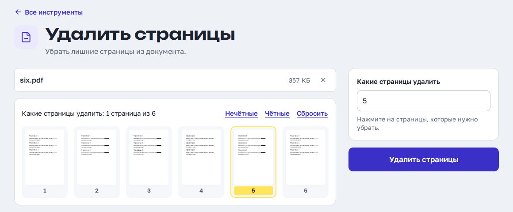

# PDF tools

An iLovePDF-style page for documents that should not go to someone else's server: contracts, passports,
bank statements. Thirty tools on one page:

| Group | Tools |
|---|---|
| Pages and files | merge (drag to order), organize pages (thumbnails: reorder, rotate, delete), split (after pages / every N pages / by size), remove pages, extract pages, rotate, page numbers, remove blank pages |
| Compression and OCR | compress (three levels, before → after sizes), OCR to searchable PDF (deskew, auto-rotate, any Tesseract language), repair |
| To PDF | Word/Excel/PowerPoint/ODF/RTF/TXT, images, e-books (EPUB/FB2/MOBI/AZW3), e-mails (EML/MSG) |
| From PDF | Word, Excel (tables), PowerPoint, images, text/RTF/Markdown, PDF/A |
| Layout | watermark (Cyrillic works), document properties, flatten, "make it look scanned" |
| Security and privacy | add password and restrictions, remove password, redact words for good, sanitize (scripts, attachments, metadata) |
| Images | compress and convert JPG/PNG/WebP |



The page is in **Russian**. All the copy lives in `pdftools/web/src/tools.js` and the components, so
translating is a text edit.

## Enable it

```bash
# .env
COMPOSE_PROFILES=...,pdftools
PDF_OCR_LANGS="eng deu fra"        # Tesseract codes; osd is added automatically
./bootstrap.sh                      # randomises PDF_PATH, fetches OCR languages, builds the page
docker compose up -d
```

The page is at `https://yourdomain/<PDF_PATH>/` and gets a card on the hub. The page build needs
**Node 20.19+** (Vite 8). The engine image is about **3.6 GB**. Give it **4 GB of RAM** (`mem_limit`).

## How it keeps documents private

- **The engine has no internet.** [Stirling-PDF](https://github.com/Stirling-Tools/Stirling-PDF) runs
  only on `pdf-internal`, a Docker network with `internal: true`. It has no route out and no host port.
  Caddy is the only other member. Even a compromised engine has nowhere to send a file.
- **Documents only touch RAM.** The engine's `/tmp` (its work files), `/logs` and `/storage` are tmpfs,
  and work files are deleted when the response is sent.
- **Only the page's endpoints are reachable.** Caddy passes through `POST /api/v1/<endpoint>` for these
  thirty tools, plus a status ping, and nothing else. Stirling also has `url-to-pdf` and `html-to-pdf`
  (server-side fetches), pipelines, an admin UI and Swagger, and all of those return 404. When you add a
  tool, add its endpoint to the `#IF:pdftools` block in `caddy/Caddyfile.l4.template`.
- **Two tools never upload at all.** *Organize pages* uses pdf.js and pdf-lib, and *Images* uses canvas.
  The page tags them "в браузере" (in the browser).
- **Nothing third-party is loaded.** Fonts are self-hosted and there is no CDN or analytics. The CSP is
  `connect-src 'self'`, and Stirling's own analytics (PostHog, Scarf) are switched off.

Why our own page instead of Stirling's UI: its UI brings accounts, an AI chat, signing workflows and
folders. Exposing it would expose its whole API too.

## Pitfalls

- **Use pdf.js's legacy build.** The modern build of pdfjs-dist 6 needs `Uint8Array.prototype.toHex`
  (Chrome 140+, Safari 18.2+). On older phones the thumbnails fail without any error, so the page imports
  `pdfjs-dist/legacy/build/…`.
- **The OCR folder needs `pdf.ttf`.** The tessdata folder is mounted over the image's own, so it must
  also hold the image's `pdf.ttf` and `configs/`. Without them OCR fails with "Tesseract … did not produce
  the expected PDF output". `fetch-tessdata.sh` copies them out of the image.
- **Page numbers can't use Cyrillic.** They are drawn in Helvetica, which has no Cyrillic, so a Cyrillic
  pattern returns 400. The page offers only number patterns.
- **Watermarks need every parameter.** The watermark draws Cyrillic fine, but only when every parameter is
  sent. Leaving the optional ones out gives a 500.
- **PDF → Excel can return 204.** It does that when there are no tables, and the page shows "nothing to save".

## Upgrade

Pin a version tag in `PDFTOOLS_IMAGE`, never `latest`. After a bump, run each tool once, because Stirling
renames parameters between majors.
